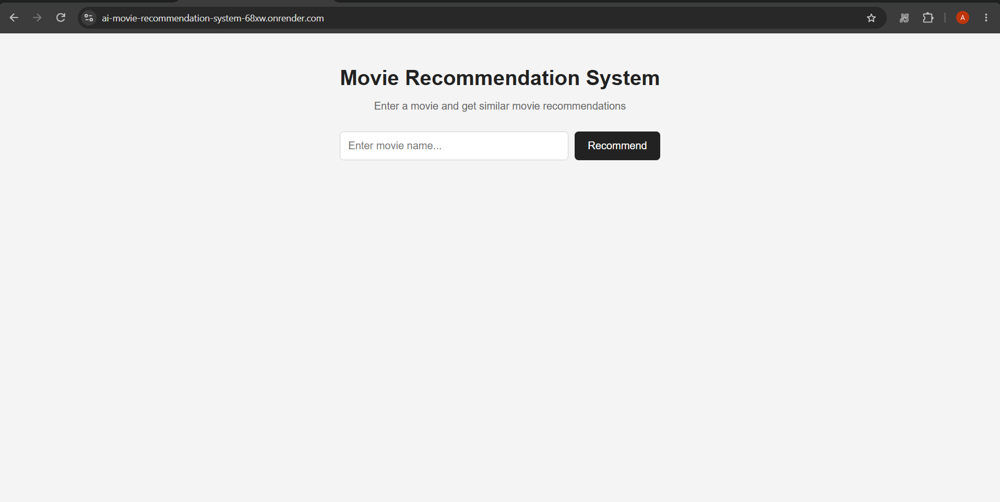
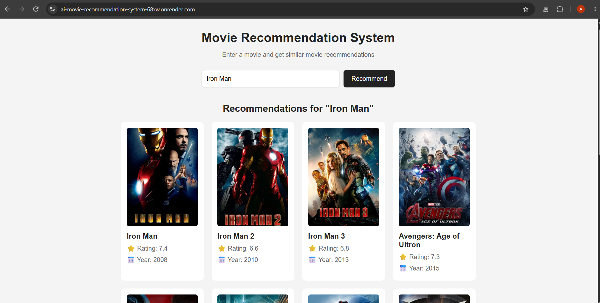

# 🎬 AI-Based Movie Recommendation System


A **content-based movie recommendation system** built with Python, Scikit-learn and Flask. Given a movie title, the system finds and displays the **9 most similar movies** using Natural Language Processing (Bag-of-Words) and the **K-Nearest Neighbors (KNN)** algorithm with **cosine distance**, trained on the **TMDB 5000 Movies and Credits** dataset.

---
## 🌐 Live Demo

🔗 Try it here: AI Movie Recommendation System

⏳ Hosted on Render's free tier, so the first load may take 30–60 seconds while the server wakes up.


Direct Link: https://ai-movie-recommendation-system-68xw.onrender.com/
---

## 📑 Table of Contents

- [Overview](#-overview)
- [Features](#-features)
- [How It Works](#-how-it-works)
- [System Architecture](#-system-architecture)
- [Tech Stack](#-tech-stack)
- [Project Structure](#-project-structure)
- [Installation & Setup](#-installation--setup)
- [Usage](#-usage)
- [Screenshots](#-screenshots)
- [Key Concepts Learned](#-key-concepts-learned)
- [Limitations & Future Scope](#-limitations--future-scope)
- [References](#-references)
- [Author](#-author)

---

## 📌 Overview

With thousands of movies available, users often face *"analysis paralysis"* when choosing what to watch. This project addresses that problem with a **content-based filtering** recommender that suggests movies similar to one the user already likes, based on:

- Plot overview
- Genres
- Keywords
- Top 3 cast members
- Director

The system follows a **two-stage pipeline**:

1. **Offline stage** – Raw movie data is cleaned, features are engineered, text is vectorized, and artifacts are saved to disk.
2. **Online stage** – A Flask web app loads the saved artifacts and returns recommendations in real time.

> **Note:** There is no supervised training with labelled targets. The "model" is built through feature extraction and vector representation, followed by nearest-neighbor retrieval.

---

## ✨ Features

- 🔍 **Search with autocomplete** over all movie titles in the dataset
- 🤖 **Content-based recommendations** using KNN + cosine distance
- 🎞️ **9 similar movies** per query, with title, rating, release year and poster
- 🖼️ **Dynamic poster loading** from the TMDB API (asynchronous, non-blocking)
- 💾 **Model persistence** with Pickle for instant startup — no retraining needed
- 🧩 **Clean separation** between ML pipeline (`generate_model.py`) and web app (`app.py`)

---

## 🧠 How It Works

### 1. Data Preparation
- Load `movies` and `credits` CSV files with Pandas and **merge them on `title`**.
- Keep only relevant columns and **drop rows with missing values**.
- Extract the **release year** from the release date.
- Parse JSON-like strings (genres, keywords, cast, crew) using `ast.literal_eval()`.
- Keep the **top 3 cast members** and the **director** (from crew job type).
- Split the **overview** into word tokens.

### 2. Feature Engineering ("Tags")
All features are merged into a single `tags` field:

```
tags = overview_words + genres + keywords + cast + crew
```

Multi-word names have spaces removed so they stay as one token (e.g. `Brad Pitt` → `BradPitt`).

### 3. Text Vectorization (Bag-of-Words)
`CountVectorizer` converts each movie's tags into a numerical vector:

| Parameter | Value | Purpose |
|---|---|---|
| `max_features` | `5000` | Keep the 5000 most frequent tokens |
| `stop_words` | `"english"` | Remove common words (a, the, is…) |

Result: a sparse matrix of shape **(~4800 movies × 5000 features)**.

### 4. Similarity Search with KNN
Movies are compared using **cosine distance**:

```
cosine_similarity(A, B) = (A · B) / (‖A‖ · ‖B‖)
cosine_distance        = 1 − cosine_similarity
```

Cosine distance is magnitude-invariant, efficient on sparse data, and works well in high-dimensional spaces.

| KNN Parameter | Value |
|---|---|
| `n_neighbors` | `10` |
| `metric` | `"cosine"` |
| `algorithm` | `"brute"` |

The nearest neighbor is the query movie itself, so it is skipped and the **remaining 9 movies** are returned as recommendations.

### 5. Persistence & Deployment
The processed movie data and the fitted vectorizer are serialized with Pickle:

- `artifacts/movie_dict.pkl`
- `artifacts/vectorizer.pkl`

The Flask app loads these on startup, so inference is fast and requires no reprocessing.

---

## 🏗️ System Architecture

```
┌─────────────────────── OFFLINE (generate_model.py) ───────────────────────┐
│ TMDB Movies + Credits → Merge → Clean → Feature Extraction →             │
│ Create "Tags" → CountVectorizer (5000-dim) → Save Artifacts (.pkl)       │
└──────────────────────────────────────┬────────────────────────────────────┘
                                       │ used by
┌──────────────────────────────────────▼─── ONLINE (app.py) ────────────────┐
│ User enters movie → Flask receives title → Lookup in dataset →           │
│ Fetch vector → KNN (cosine, k=10) → Exclude input movie →                │
│ Top 9 results → Fetch posters from TMDB API → Display recommendations    │
└───────────────────────────────────────────────────────────────────────────┘
```

---

## 🛠️ Tech Stack

| Technology | Role |
|---|---|
| **Python** | Core programming language |
| **Pandas** | Data loading, merging, cleaning and transformation |
| **Scikit-learn** | `CountVectorizer` (text → vectors), `NearestNeighbors` (similarity search) |
| **Flask** | Web framework, routing, Jinja2 templating |
| **Pickle** | Saving/loading model artifacts |
| **HTML / CSS / JavaScript** | Frontend UI and async poster fetching |
| **TMDB Dataset** | ~5000 movies with rich metadata |
| **TMDB API** | Movie poster retrieval |

---

## 📂 Project Structure

```
AI-Movie-Recommendation-System/
│
├── artifacts/            # Serialized model artifacts (movie_dict.pkl, vectorizer.pkl)
├── data/                 # TMDB 5000 Movies & Credits CSV files
├── templates/            # HTML templates (Jinja2) for the web interface
├── app.py                # Flask application – serves UI & generates recommendations
├── generate_model.py     # Offline pipeline – preprocessing, vectorization, saving artifacts
├── requirements.txt      # Python dependencies
└── README.md             # Project documentation
```

---

## ⚙️ Installation & Setup

### Prerequisites
- Python 3.8 or higher
- `pip` package manager
- A free [TMDB API key](https://developer.themoviedb.org/docs/getting-started) (for movie posters)

### Steps

**1. Clone the repository**
```bash
git clone https://github.com/iam-aryanjaiswar/AI-Movie-Recommendation-System.git
cd AI-Movie-Recommendation-System
```

**2. (Optional) Create a virtual environment**
```bash
python -m venv venv

# Windows
venv\Scripts\activate

# macOS / Linux
source venv/bin/activate
```

**3. Install dependencies**
```bash
pip install -r requirements.txt
```

**4. Add the dataset** *(skip if already in `data/`)*
Download the [TMDB 5000 Movie Dataset](https://www.kaggle.com/datasets/tmdb/tmdb-movie-metadata) from Kaggle and place the movies and credits CSV files inside the `data/` folder.

**5. Generate the model artifacts** *(skip if `artifacts/` already contains the `.pkl` files)*
```bash
python generate_model.py
```

**6. Run the web application**
```bash
python app.py
```

**7. Open in your browser**
```
http://127.0.0.1:5000
```

---

## 🚀 Usage

1. Open the web app in your browser.
2. Type a movie name in the search box (autocomplete will suggest titles).
3. Click **Recommend**.
4. View **9 similar movies** with their posters, ratings and release years.

If the movie isn't found in the dataset, the app displays a "Movie not found" message.

---

## 🖼️ Screenshots


**Home Page**



**Recommendations for "Iron Man"**



**Sample output:** Searching for *Iron Man* returns *Iron Man 2*, *Iron Man 3*, *Avengers: Age of Ultron*, *Captain America: Civil War*, *X-Men: The Last Stand*, and more.

---

## 📚 Key Concepts Learned

- Feature engineering — combining heterogeneous data into a unified representation
- Text vectorization with Bag-of-Words so ML algorithms can process language
- Distance metrics (cosine) to quantify similarity in high-dimensional space
- Nearest-neighbor search for efficient retrieval
- Offline/online architecture separating expensive preparation from fast inference
- Model serialization for deployment without retraining
- Integrating an ML model into a Flask web application

---

## 📖 References

1. [Scikit-learn: Nearest Neighbors](https://scikit-learn.org/stable/modules/neighbors.html)
2. [Scikit-learn: Feature extraction from text](https://scikit-learn.org/stable/modules/feature_extraction.html#text-feature-extraction)
3. [Flask Documentation](https://flask.palletsprojects.com/)
4. [Pandas Documentation](https://pandas.pydata.org/docs/)
5. [TMDB Movie Metadata Dataset (Kaggle)](https://www.kaggle.com/datasets/tmdb/tmdb-movie-metadata)
6. [TMDB API Documentation](https://developer.themoviedb.org/docs/getting-started)
7. [Cosine Similarity – Wikipedia](https://en.wikipedia.org/wiki/Cosine_similarity)
8. Aggarwal, C. C. — *Recommender Systems*, Springer, 2016.
9. Ricci, F., Rokach, L., & Shapira, B. (Eds.) — *Recommender Systems Handbook* (2nd ed.), Springer, 2015.

---

## 👤 Author
**Aryan Jaiswar**

- GitHub: [@iam-aryanjaiswar](https://github.com/iam-aryanjaiswar)


---

⭐ If you found this project useful, consider giving the repository a star!
